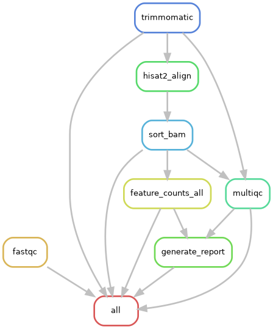

# uci_grthub_rnaseq_pipeline

[](https://github.com/uci-grthub/uci_grthub_rnaseq_pipeline/actions/workflows/ci.yml)

This is the bulk RNA-seq workflow of the UCI Genomics Research and Technology
(GRT) Hub, written in Snakemake. It is released in tagged versions, tested on
every PR, and each release is archived on Zenodo with a DOI.



## What it does

| Step | Tool |
| --- | --- |
| Raw read QC | FastQC |
| Adapter/quality trimming | chelae |
| Alignment (lanes of a library aligned together) | HISAT2 |
| Sort, fixmate, duplicate marking | samtools |
| Gene counts, count/CPM matrices | featureCounts, R |
| Transcript quantification, gene TPM | Salmon, tximport |
| Sample QC: correlation, clustering, PCA | DESeq2 (VST) |
| Post-alignment RNA QC | RustQC |
| QC report | MultiQC |
| Project report | `RNAseq_Project_Report.pdf` |
| On request: splicing, GEO/SRA package, DESeq2 | rMATS, Python, DESeq2 |

Samples are aligned to the reference for their species (`species` column).
The available species are human GRCh38, mouse GRCm38, and macaque Mmul_10 and
T2T-MMU8; see `config/references.yaml`.

## Quick start (HPC3)

```bash
# 1. Install a release (once per version)
git clone --branch v1.0.0 --depth 1 \
    https://github.com/uci-grthub/uci_grthub_rnaseq_pipeline rnaseq-v1.0.0
(cd rnaseq-v1.0.0 && pixi install --all)

# 2. Make a project directory
mkdir my_project && cd my_project
mkdir -p data/FASTQ        # <sample>-R1.fastq.gz / <sample>-R2.fastq.gz
cat > config.yaml <<'EOF'
default_species: human
ncbi:
  tissue: "liver"
EOF

# 3. Dry run, fill in metadata/metadata.csv (written on the first run), then run
export SLURM_ACCOUNT=<your_lab_account>
sbatch -A $SLURM_ACCOUNT ../rnaseq-v1.0.0/scripts/run_hpc3.sbatch -n
sbatch -A $SLURM_ACCOUNT ../rnaseq-v1.0.0/scripts/run_hpc3.sbatch
```

[docs/usage.md](docs/usage.md) covers the sample sheet, configuration,
optional targets, HPC3 modules vs pixi, and migrating projects from before
v1.0. [docs/outputs.md](docs/outputs.md) lists every deliverable.

The core runs tagged releases only, never `main`. Each run writes
`output/versions.yaml` with the pipeline version, commit, software lock hash,
tool versions and references. Record the version in the delivery notes.

## Repository layout

```
workflow/   Snakefile (includes only), rules/*.smk, scripts/, schemas/, resources/
config/     config.yaml (defaults), references.yaml, example comparisons file
profiles/   hpc3/ Snakemake SLURM profile
scripts/    reference builders, FASTQ rsync, HPC3 controller job
tests/      test data (public, 10 Mb chr22 window), expected outputs, comparison script
docs/       usage, outputs, METHODS.md (methods text + citations)
notebooks/  exploratory only, not run by the pipeline
extras/     iSEE Shiny app (not part of the pipeline)
```

## Development

```bash
pixi install --all
pixi run lint                 # snakefmt --check, ruff, snakemake --lint
pixi run tests/run_test.sh    # full pipeline on tests/data, compared to tests/expected
```

CI runs both on every PR. `tests/compare_outputs.py` applies the comparison
rules:

- counts must match exactly
- Salmon TPM must correlate at r > 0.999
- QC rates must agree within 0.1 percentage points
- rMATS event counts must be equal
- the report and GEO package must be complete

A PR that changes results also updates `tests/expected/` and explains why.

Releases are cut by release-please from Conventional Commit PR titles:

- `fix:` makes a patch release.
- `feat:` makes a minor release.
- `feat!:`, or any change to results, makes a major release.

Before merging a release PR, run the full-size regression on HPC3
(`tests/regression/run_regression.sbatch`) and attach its summary to the PR.

Formatting note: `snakefmt` is pinned in `pixi.toml`. Reformatting changes
rule code, and Snakemake reruns rules whose code changed, so formatting lands
in its own PR, never alongside a live project.

## Citation

Cite the DOI of the release you ran (see the GitHub release or
[CITATION.cff](CITATION.cff)) and the tools in [docs/METHODS.md](docs/METHODS.md).

## License

MIT; see [LICENSE](LICENSE). rMATS is free for non-commercial use only; see
its license.

## Contact

Kevin Stachelek (kstachel@uci.edu), UCI GRT Hub.
